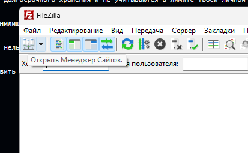
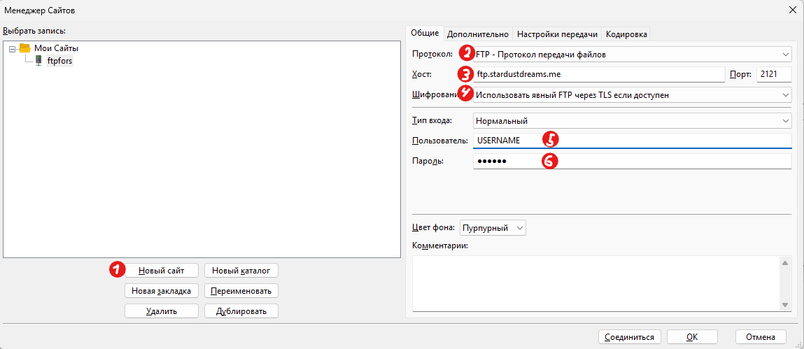

# ✦ Stardustdreams FTP Storage
### Personal File Storage & Sharing System

## 🇷🇺 Русский

### 1. Добро пожаловать!

Добро пожаловать, на FTP-хранилище **Stardustdreams**!

Мы рады видеть тебя среди пользователей нашего хранилища. Здесь ты можешь хранить свои файлы, обмениваться ими с другими пользователями и управлять собственным файловым пространством.

Хранилище состоит из двух основных директорий:

| Директория | Доступ | Описание |
|---|---|---|
| `USERNAME/` | Личный | Твоя персональная папка. Доступ к ней есть только у тебя. |
| `Общее/` | Общий | Папка для обмена файлами, доступная всем зарегистрированным пользователям. |

**Твоя конфиденциальность важна.** Другие пользователи не имеют доступа к твоей личной директории и её содержимому.

### 2. Ограничения хранилища

Для личной директории установлен лимит хранения — **50 ГБ**.

Если тебе необходимо загрузить файл, размер которого превышает доступное пространство, либо место в личной директории закончилось, воспользуйся системой долгосрочного хранения.

Для этого достаточно добавить специальную приставку в начало названия файла:

`temp_`

**Примеры:**
- `Project.zip` → `temp_Project.zip`
- `Backup.rar` → `temp_Backup.rar`
- `Video.mp4` → `temp_Video.mp4`

Файлы с приставкой `temp_` предназначены для долгосрочного хранения и не учитываются в лимите твоей личной директории (50 ГБ).

### 3. Получение файлов из долгосрочного хранилища

Файлы, загруженные в долгосрочное хранилище, нельзя получить напрямую через личную директорию.

Для получения необходимого файла нужно отправить серверу запрос с помощью JSON-файла, содержащего соответствующую команду.

**Пример запроса (`request.json`):**

```json
{
  "command": "get_file",
  "filename": "temp_Project.zip"
}
```

После получения запроса сервер обработает его и запустит процесс выдачи запрошенного файла.

*Примечание: это пример формата запроса. Используй названия команд и полей, поддерживаемые сервером.*

### 4. Основные правила использования

- Поддерживай порядок в своей личной директории.
- Используй папку `Общее` только для файлов, которыми хочешь поделиться с другими пользователями.
- Соблюдай ограничение в 50 ГБ для личного хранилища.
- Используй приставку `temp_` для файлов, требующих долгосрочного хранения.
- Не передавай свои учётные данные третьим лицам.
- Не загружай незаконные или вредоносные файлы.

### 5. Данные для подключения

| Параметр | Значение |
|---|---|
| Протокол | FTP |
| Сервер | `ftp.stardustdreams.me` |
| Порт | `2121` |
| Логин | Выданное тебе имя пользователя |
| Пароль | Твой персональный пароль |

Для подключения рекомендуем использовать программу **FileZilla**.

## Инструкция по добавлению сервера в **FileZilla**

### 1. Скачайте программу с [официального сайта](https://filezilla-project.org/) и становите на свой ПК.
### 2. После установки откройте программу и откройте менеджер файлов 

### 3. У вас откроется окно Менеджера сайтов, в котором вы добавите наше хранилище.

1. Нажмите на "Новый сайт"
2. Выберите протокол "FTP - Протокол передачи файлов"
3. Введите хост 'ftp.stardustdreams.me'
4. Шифрование выберите "Использовать явный FTP через TLS если доступен"
5. Введите логин который вам выдали
6. Введите пароль который вам выдали
7. Нажмите ОК
---

*Спасибо, что являешься частью Stardustdreams!*

**Stardustdreams — Твои файлы. Твоё пространство. Твоя вселенная.**

---

<sub>© Stardustdreams — Personal File Storage System</sub>
